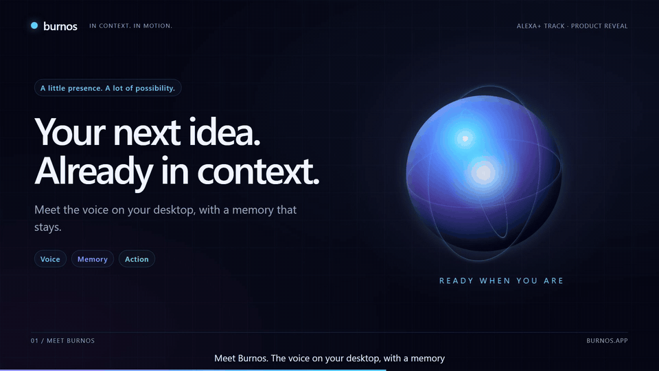
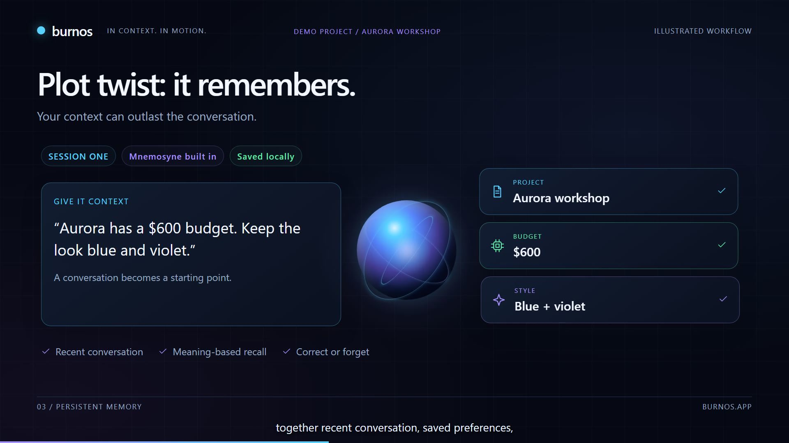
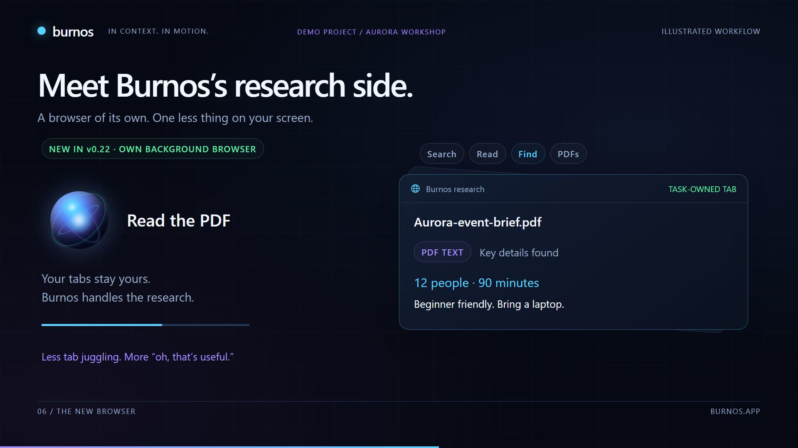
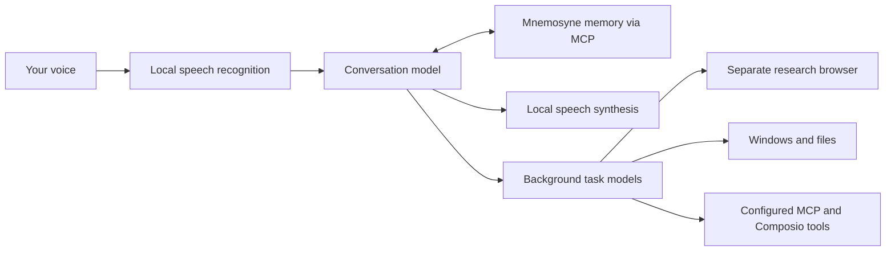

<div align="center">

# Burnos

### Your next idea. Already in context.

A voice assistant for Windows that remembers the conversation and helps move your work forward.

[](docs/GETTING_STARTED.md)
[](BurnOS.pro)
[](LICENSE)

[Explore Burnos](https://burnos.app) · [Download the 2:59 reveal](https://github.com/onfire7777/Burnos/raw/refs/heads/main/media/burnos-overview.mp4) · [Get started](docs/GETTING_STARTED.md) · [Judge's guide](docs/hackathon/README.md)

[](https://github.com/onfire7777/Burnos/raw/refs/heads/main/media/burnos-overview.mp4)

[Still image](docs/assets/burnos-hero.jpg) · [Transcript and captions](media/burnos-overview.srt)

</div>

## Less repeating yourself. More getting things done.

Say what you need. Keep talking while Burnos works. Return later with your context still available through its integrated memory system.

Burnos brings conversation, persistent memory, research, and desktop actions into one small orb. It is a native C++/Qt application, with local speech recognition and synthesis, OpenRouter for reasoning, and Mnemosyne for memory.

| You want to… | Burnos brings… |
| --- | --- |
| Pick up where you left off | **Persistent memory.** Conversation history, preferences, and retrieval through the integrated Mnemosyne backend. |
| Stay in the conversation | **Background tasks.** Separate talking and working models, with progress, steering, and cancellation. |
| Research without rearranging your desktop | **A browser of its own.** Search, read pages and PDFs, follow links, and gather context in a separate browser profile. |
| Turn an answer into useful work | **Desktop tools.** Work with files, run commands, operate applications, and dictate into a text field. |
| Connect your existing services | **MCP and Composio.** Extend the assistant with the tools and accounts you configure. |
| Make it feel like yours | **Personal controls.** Model and voice selection, wake-word mode, optional speaker matching, and spoken controls. |

## One idea, one connected workflow

Imagine planning a beginner design workshop:

1. **Set the context:** “Remember that Aurora is a beginner workshop. Keep the plan to 90 minutes and the budget to $600.”
2. **Keep moving:** Ask Burnos to research activities while you discuss the agenda.
3. **Make something useful:** Have it draft a local planning brief using those constraints.
4. **Come back later:** Restart the app and ask it to continue from the saved workshop context.

This is the fictional scenario in the reveal film. Connected services require your configuration; generated plans and actions should be reviewed.

<table>
  <tr>
    <td width="50%"></td>
    <td width="50%"></td>
  </tr>
  <tr>
    <td><strong>Context that carries forward.</strong><br />Give the next conversation a head start.</td>
    <td><strong>Research that keeps you in flow.</strong><br />Bring useful information back to the task.</td>
  </tr>
</table>

*Images are frames from our animated product reveal, not native-app screenshots. The film includes a separately executed memory persistence test; see [demo evidence and limitations](docs/hackathon/DEMO.md).*

## Run it on your desktop

Burnos currently targets **Windows x64**. You will need a Qt 6 development kit, the speech runtimes, and an OpenRouter key for reasoning. Install Mnemosyne to enable persistent memory. The setup guide covers each dependency and where it belongs.

```powershell
git clone https://github.com/onfire7777/Burnos.git
cd Burnos
.\build.bat -QtRoot C:\Qt\6.11.2\mingw_64 -CompilerBin C:\Qt\Tools\mingw1310_64\bin
```

Adjust the Qt paths to your installation. The build deploys Qt alongside the executable; [finish the runtime setup before launching](docs/GETTING_STARTED.md).

**Useful controls:** click the orb to mute/unmute; double-click to stop; configure a hold-to-dictate shortcut in Settings. Wake-word and speaker matching are optional. Muting conversation is not a hardware microphone disconnect: local wake/command detection can remain active.

## Local foundations. Connected intelligence.



Speech is processed locally by the configured speech runtimes. Reasoning uses OpenRouter; selected text, context, tool results, and screenshots can leave the machine. Semantic memory retrieval may use remote embeddings. Burnos is **not an entirely offline assistant**. Read the short [data and control guide](docs/PRIVACY.md).

## For hackathon judges

Start with the [submission guide](docs/hackathon/README.md) for the Alexa+ simulated-experience positioning, significant updates, reproducible demo steps, product feedback, and five documented friction-log entries. Burnos is an independent desktop assistant; it is not an official Amazon product or a deployed Alexa integration.

| Explore | What you will find |
| --- | --- |
| [Getting started](docs/GETTING_STARTED.md) | Build, speech runtimes, memory, first run, and troubleshooting |
| [Architecture](docs/ARCHITECTURE.md) | The source files behind each feature |
| [Demo and evidence](docs/hackathon/DEMO.md) | Video chapters, test provenance, and a live recording plan |
| [Development during the hackathon](docs/hackathon/DEVELOPMENT.md) | Dated changes with commit links |
| [Product feedback](docs/hackathon/PRODUCT_FEEDBACK.md) | Tool-by-tool observations and remaining author responses |
| [Friction log](docs/hackathon/friction-log.md) | Actual issues, fixes, and supporting commits |
| [Editable film](media/remotion/README.md) | Remotion source and rendering instructions |

## Build with us

Bug reports and focused improvements are welcome. Read [CONTRIBUTING.md](CONTRIBUTING.md) before opening a pull request and [SECURITY.md](SECURITY.md) for private vulnerability reporting.

Burnos-authored code and documentation are available under the [MIT License](LICENSE). Included third-party files, external runtimes, models, and services retain their own terms; see [THIRD_PARTY_NOTICES.md](THIRD_PARTY_NOTICES.md).
